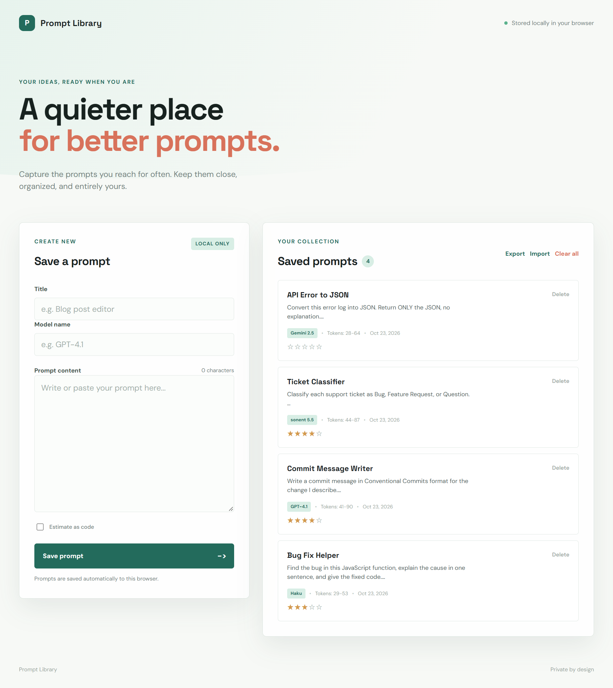

# 📚 Prompt Library

A lightweight, browser-based prompt library for saving, rating, annotating, and backing up your best AI prompts. Built with **vanilla HTML, CSS, and JavaScript**. No frameworks, no build step, no backend.

The twist: **every feature was built by prompting an AI assistant**, and each feature uses a **different prompt engineering technique**. The repo doubles as a hands-on log of what each technique is good for.

> Built while following [Practical Prompt Engineering for Developers](https://sgoldfarb2.github.io/practical-prompt-engineering/) by **Sabrina Goldfarb** (Frontend Masters).

<!-- Add a screenshot or GIF: save it as screenshot.png in the repo root -->



🔗 **Live demo:** [subhash575.github.io/prompt-library](https://prompt-library-flame-gamma.vercel.app/)

---

## ✨ Features

- **Save & delete prompts.** Title, model name, and content, stored in `localStorage` with a live character counter. Deleting asks for confirmation.
- **Expandable prompt cards.** Each card shows a summary (model badge, token range, date, rating). Click it or press Enter/Space to see the full prompt and details.
- **⭐ 5-star rating.** Rate how effective each prompt is.
- **📝 Notes.** Add, edit, and delete notes per prompt (e.g. _"worked better on Claude"_, _"few-shot version"_).
- **📊 Metadata tracking.** Model used, created/updated timestamps (ISO 8601), and a token estimator with an optional **"Estimate as code"** mode and color-coded confidence (high / medium / low).
- **💾 JSON export / import.**
  - Export downloads a timestamped file with a version number and library statistics (total prompts, average rating, most-used model).
  - Import validates every field, including IDs, ratings, token estimates, and notes, and checks for duplicate IDs.
  - You choose to **replace** your library or **merge** into it, deciding per duplicate whether to keep or overwrite.
  - If anything fails, the import is **rolled back** automatically.
- **Clear all**, with confirmation.
- **Accessible.** Semantic HTML, ARIA labels, keyboard support, and one interactive rating control per card.

---

## 🔒 Security & Reliability

- **Safe imports.** Imported files are strictly validated. IDs must match a safe character pattern, ratings must be whole numbers from 0 to 5, confidence must be `high`, `medium`, or `low`, and every note needs a valid ID and content. Anything else is rejected and rolled back.
- **Escaped output.** All user and imported values, including text, IDs, and attributes, are HTML-escaped before rendering, which prevents XSS from crafted JSON files.
- **Clean data.** Temporary UI state (such as which note is being edited) is never written to `localStorage` or to export files.
- **Backward compatible.** Older saved data without metadata is upgraded automatically on load.

---

## 🧠 Prompting Techniques Used

| #   | Feature                    | Technique             | How it was applied                                                                                                                                                          |
| --- | -------------------------- | --------------------- | --------------------------------------------------------------------------------------------------------------------------------------------------------------------------- |
| 1   | First scaffold             | **Standard prompt**   | A plain, direct request for a prompt library. It worked, but the model added assumptions and extra features. I threw it away.                                               |
| 2   | Save / delete scaffold     | **Zero-shot**         | A precise list of requirements ending with _"includes no other features"_. No examples were needed for a task the model has seen many times.                                |
| 3   | Star rating                | **One-shot**          | One fully worked feature plan (a favorites system) as the example. Then I asked for the rating feature in the **exact same format**: user story, requirements, code, UI/UX. |
| 4   | Notes                      | **Few-shot**          | Two different example feature prompts showed the model what a good spec looks like. It wrote the notes spec first, and then built it.                                       |
| 5   | Metadata + token estimator | **Structured output** | Exact function signatures (`trackModel`, `updateTimestamps`, `estimateTokens`), validation rules, and a JSON output schema.                                                 |
| 6   | Export / import            | **Chain of thought**  | Five explicit steps: analyze data → design schema → export → import → error recovery, ending with _"Think step by step."_                                                   |
| 7   | Production research        | **Delimiters / XML**  | `<research_area>`, `<topic>`, and `<questions>` tags organized a large research request about taking the app to production.                                                 |
| 8   | Architecture plan          | **Persona**           | _"You are a Senior Engineer with experience building startups from zero to MVP"_ got opinionated trade-offs on database, auth, API design, and scaling.                     |
| —   | Throughout                 | **Context placement** | A fresh chat per feature and per fix, with the most important instructions first. Models tend to lose information buried in the middle of long contexts.                    |

Techniques 7 and 8 were used for planning, so they shaped the [roadmap](#️-roadmap) rather than the code.

### Example: structured output prompt (metadata feature)

```text
Create a metadata tracking system for a prompt journal web application
that is attached to our prompts in our prompt library.

FUNCTION SPECIFICATIONS:
1. trackModel(modelName: string, content: string): MetadataObject
2. updateTimestamps(metadata: MetadataObject): MetadataObject
3. estimateTokens(text: string, isCode: boolean): TokenEstimate
   - min = 0.75 * word_count, max = 0.25 * character_count
   - If isCode=true, multiply both by 1.3

OUTPUT SCHEMA:
{
  model: string,
  createdAt: string (ISO 8601),
  updatedAt: string (ISO 8601),
  tokenEstimate: { min: number, max: number, confidence: 'high' | 'medium' | 'low' }
}

CONSTRAINTS:
- Pure JavaScript only (no external libraries)
- Include try/catch error handling
```

---

## 🛠️ AI-Assisted Code Review

After the features were built, I ran an AI code review of the whole codebase. Then I used **Claude Code** to fix the findings one at a time, with one commit per fix:

| Fix             | What changed                                            |
| --------------- | ------------------------------------------------------- |
| `fix(security)` | Validate and escape imported prompt data to prevent XSS |
| `fix`           | Confirm before deleting a prompt                        |
| `fix(a11y)`     | Render one interactive star group per card              |
| `fix`           | Keep note editing state out of storage and exports      |
| `refactor`      | Remove an unused import backup key                      |
| `chore`         | Add `.gitignore`                                        |

---

## 🗂️ Data Model

Each prompt in `localStorage` (key: `prompt-library-items`):

```js
{
  id: "3f2b9c1e-...",            // crypto.randomUUID(), letters, digits, ".", "_", "-" only
  title: "Code Reviewer",
  content: "You are a senior engineer focused on security...",
  rating: 4,                      // integer 0–5
  notes: [
    { id: "a81c...", content: "Best results with Claude", createdAt: 1761213000000, updatedAt: 1761213000000 }
  ],
  metadata: {
    model: "Claude",
    createdAt: "2026-10-20T10:15:00.000Z",
    updatedAt: "2026-10-21T08:02:00.000Z",
    tokenEstimate: { min: 12, max: 15, confidence: "high" }
  }
}
```

Export file shape:

```js
{
  version: 1,
  exportedAt: "2026-10-23T14:30:00.000Z",
  statistics: { totalPrompts: 12, averageRating: 4.17, mostUsedModel: "Claude" },
  prompts: [ /* ... */ ]
}
```

The metadata helpers are exposed for quick testing in the browser console:

```js
promptMetadata.estimateTokens("function add(a, b) { return a + b; }", true);
```

---

## 🚀 Getting Started

```bash
git clone https://github.com/Subhash575/prompt-library.git
cd prompt-library
```

Open `index.html` in your browser, or use the VS Code **Live Server** extension. Any static server also works:

```bash
npx serve .
# or
python -m http.server 8000
```

> **Note:** Your data lives in this browser's `localStorage`. Clearing site data deletes it, so use **Export** regularly to back it up.

---

## 📁 Project Structure

```
prompt-library/
├── index.html    # Layout: prompt form, library panel, export/import controls
├── style.css     # Mint/teal theme (DM Sans + Space Grotesk), cards, stars, confidence badges
├── script.js     # Storage, validation, rendering, rating, notes, metadata, export/import + rollback
├── .gitignore
└── README.md
```

---

## 💡 What I Learned

- **A prompt is a spec.** The vague first prompt gave a vague, over-engineered result. The zero-shot version with tight requirements gave exactly what I asked for.
- **Examples beat explanations.** One or two good examples (one-shot and few-shot) got the output format right far more reliably than instructions alone.
- **Schemas make AI output usable in code.** The structured output prompt mapped almost one-to-one onto real functions with validation.
- **Break big features into steps.** Chain of thought made the export/import feature, the most complex part, manageable: validation, merge prompts, and rollback.
- **AI-generated code still needs review.** The review caught a real XSS risk in the import flow. Writing the code with AI is fast, but checking it is still my job.

---

## 🛣️ Roadmap

- [ ] Search and filter by title, model, or rating
- [ ] Edit an existing prompt and copy it to the clipboard
- [ ] Tag prompts by technique (zero-shot, few-shot, CoT…)
- [ ] Backend + auth (PostgreSQL + Prisma) so teams can share prompts
- [ ] Prompt version history

---

## 🙏 Credits

- Course: [Practical Prompt Engineering for Developers](https://sgoldfarb2.github.io/practical-prompt-engineering/) by [Sabrina Goldfarb](https://github.com/sgoldfarb2), Frontend Masters
- Research referenced in the course: _Language Models are Few-Shot Learners_, _Large Language Models are Zero-Shot Reasoners_, _Lost in the Middle_

## 👤 Author

**Subhash Rana**
[GitHub](https://github.com/Subhash575) · [Portfolio](https://subhash.live)
